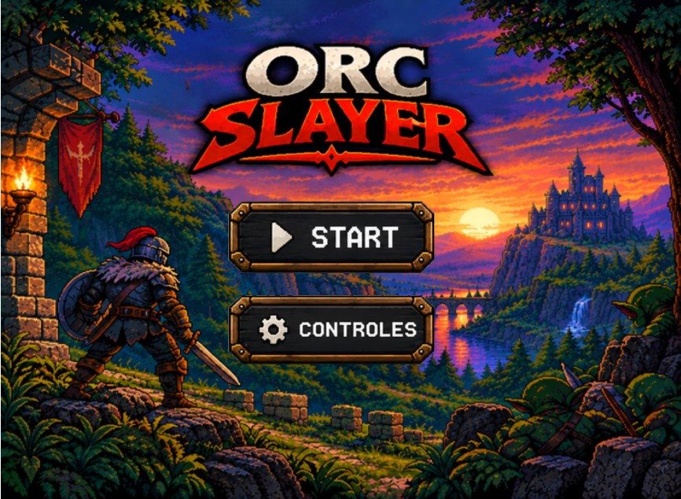
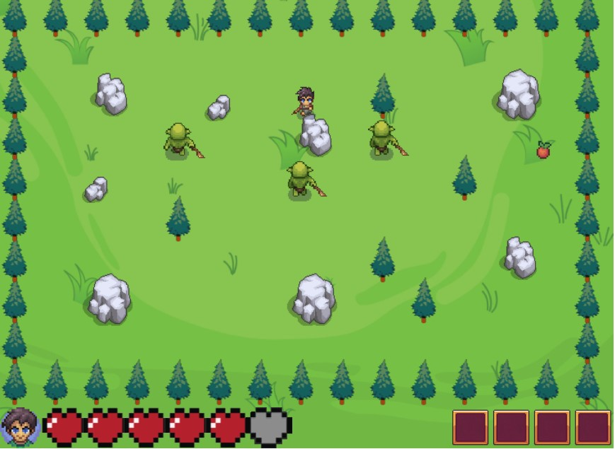
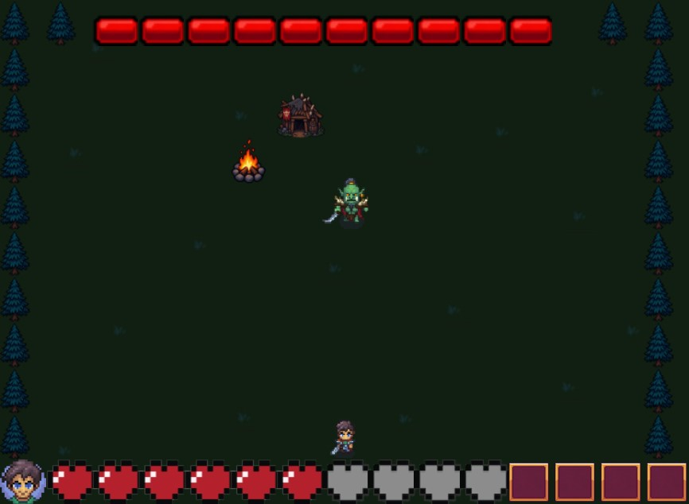
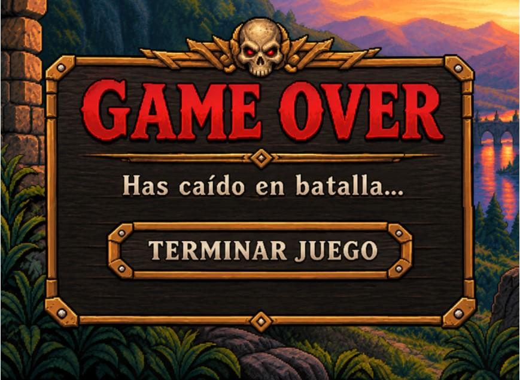

# Orc Slayer

## Equipo de desarrollo

- Braian Cadillac
- Tobias Soto Franco

## Sinopsis

**Orc Slayer** es un juego de acción y supervivencia ambientado en un mundo de fantasía medieval. El jugador controla a Torvek, un guerrero que al volver de una batalla encuentra a toda su aldea destruida a manos de una invación de orcos, el deberá enfrentarse a hordas de orcos, recolectar recursos, subir de nivel y superar distintos desafíos hasta llegar al enfrentamiento final contra Azog, el Rey Orco.

A medida que avanza la aventura, los enemigos se vuelven más peligrosos y será necesario aprovechar los objetos disponibles y las mejoras del personaje para sobrevivir.

## Capturas

## Reglas de Juego / Instrucciones

### Objetivo

El objetivo es superar los tres niveles del juego, derrotando a los enemigos y finalmente venciendo al Rey Orco.

### Controles

- **Flechas del teclado:** Mover a Torvek
- **Espacio:** Atacar
- **E:** Interactuar y recoger objetos
- **T:** Transformarse al reunir los materiales necesarios
- **Enter:** Confirmar, avanzar las secuencias o finalizar el juego
- **C:** Abrir la pantalla de controles

### Desarrollo del juego

- **Nivel 1:** derrotar a 20 orcos y alcanzar el nivel 2 de Torvek para avanzar al siguiente nivel.
- **Nivel 2:** derrotar a 10 goblins y alcanzar el nivel 3 de Torvek para continuar.
- **Nivel 3:** enfrentarse al Rey Orco y derrotarlo para completar la aventura.

### Objetos y mejoras

- **Manzanas:** permiten recuperar un punto de vida.
- **Pociones:** proporcionan recuperación de salud.
- **Materiales de crafteo:** se pueden recolectar durante la partida. Al reunir los cuatro materiales necesarios, el guerrero puede transformarse y mejorar sus capacidades.

### Consejos

- Evitá recibir ataques innecesarios de los enemigos.
- Aprovechá las manzanas y pociones para recuperar salud.
- Recolectá los materiales de crafteo para poder transformarte.
- Administrá tu salud y preparate para el enfrentamiento final.

## Otros

- Objetos I / Universidad Nacional de Quilmes
- Versión de wollok: 1.0.3